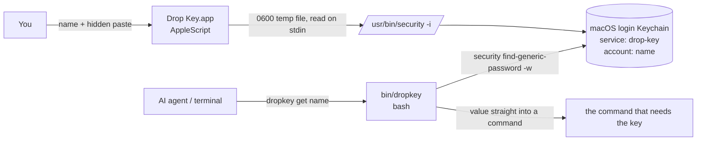

# Architecture

Two small pieces share one Keychain service.

## Writing a key (the app)

1. Two `display dialog` prompts: the name (checked against `[A-Za-z0-9._-]`, max 100 characters), then the key with `hidden answer`, so it never shows on screen.
2. The value is trimmed and refused if it contains a line break.
3. **It never puts the secret on a command line.** Command-line arguments are visible to other processes on the Mac (`ps`). Instead, the app:
   - creates a temp file with `umask 077` (only you can read it) inside your per-user temp folder
   - writes one `add-generic-password` command into it, with the value in double quotes and `\` and `"` escaped
   - runs `/usr/bin/security -i < file` so `security` reads the command from stdin, then deletes the file
   - Trade-off, stated plainly: for a fraction of a second the key sits in that private file, and `rm` isn't a secure wipe. If the app is force-quit at exactly that moment, the file stays in your temp folder (`$TMPDIR/dropkey.*`) until macOS clears it. We chose this over the command-line route because argv is readable by every process, while the file is readable only by you.
4. Saved with `-U` (replace if it exists) and `-T /usr/bin/security`, which puts the `security` tool on the item's access list so later reads don't prompt.
5. It reads the value back through a pipe and compares it, so a failed overwrite can't leave the old value while saying "saved". Then it shows a notification.

`osascript src/DropKey.applescript --save <name> <value>` runs step 3 without dialogs. Only the smoke test uses this, and it does put the value in argv, so don't use it with real keys.

## Reading a key (the CLI)

`bin/dropkey` is a thin wrapper over `/usr/bin/security`:
- `get`: `find-generic-password -w`, which prints only the value
- `has`: the same lookup without `-w`, output discarded
- `list`: walks `security dump-keychain` attributes and prints the account names for this service. It never asks for values, so it never triggers a prompt or prints a secret.
- `delete`: `delete-generic-password`

## Where the seams are

- **Service name:** `property serviceName` in the app, `DROPKEY_SERVICE` in the CLI.
- **Storage backend:** everything goes through `/usr/bin/security`. Swapping to a Swift helper using `SecItemAdd` (e.g. for Touch ID) only changes `saveKey` and the CLI's `get`.

## Threat model, honestly

It protects against keys sitting in chat transcripts, shell history, `.env` files committed by mistake and screenshots. It doesn't protect against malware running as you: anything that can run `security find-generic-password` as your user can read these keys, the same as any login-keychain item that `security` is allowed to read.
